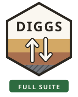
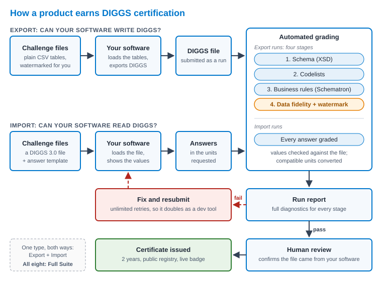

# Trust, but Verify: Introducing DIGGS Certified Software

*Ross Cutts (Schnabel Engineering), Scott Deaton (Dataforensics), and Alireza Afkhami (Rocscience)*



---

## The Problem: "Supports DIGGS" Has Been an Honor System

Ask a software vendor whether their product supports DIGGS and you will almost always hear "yes." Until now, there has been no way to check that answer before you bet a project on it.

The trouble is that "supports DIGGS" can mean a lot of things. A file can pass the DIGGS schema check and still be wrong where it counts. It might drop half the SPTs from a boring, write a depth in feet where the file says meters, leave groundwater observations behind, or attach a lab test to the wrong sample. Schema validation tells you the file is shaped correctly. It does not tell you the data inside it survived the trip.

Most engineers find this out at handoff. The file arrives, it opens, and somebody spends an afternoon comparing it against the PDF log to see what went missing. That is the same manual re-checking DIGGS was supposed to eliminate, and it erodes trust in the standard itself.

## The Turning Point: A Test Anyone Can Check

Geosetta has launched the **DIGGS Certification Program**, a free, challenge-based program that grades vendor software against the DIGGS standard and publishes the results in a public registry.

The program was developed by a member of the DIGGS committee. It is built and operated by Geosetta and validates against the same published schema, codelists, and business rules that the ASCE Geo-Institute's DIGGS committee maintains. Certification is free to vendors thanks to support from Rocscience's RSLog.

The program covers the four data types that make up most day-to-day geotechnical data exchange, in both directions:

| Data type | What the challenge contains |
|---|---|
| **SPT** | Borings with Standard Penetration Tests, lithology, and groundwater, including weight-of-hammer and weight-of-rod tests |
| **CPT** | Piezocone soundings with full qc, fs, and u2 channels |
| **Lab** | A 12-sample program: water content, Atterberg limits, wash No. 200, gradation with hydrometer, USCS classification, specific gravity, unit weight, organic content, Standard Proctor, and corrosion |
| **MWD** | Measurement-while-drilling records in both the depth domain and the time domain, including rod changes |

Each data type is certified separately for **export** (your software writes DIGGS) and **import** (your software reads DIGGS). A product that holds both for a data type is listed as **Export + Import**, and a product that holds all eight is listed as **Full Suite**.

## How Grading Works

Certification is built around a simple idea: give the software real data, and check what comes out the other end.

**Export challenges** hand the vendor a package of plain CSV tables, deliberately not DIGGS or AGS, so nobody can pass by copying a file through. The vendor loads the data into their software, exports DIGGS, and submits it. The submission then goes through four automated stages:

1. **Schema (XSD):** Is the file structurally valid DIGGS?
2. **Codelists:** Are test methods, units, and classifications drawn from the published DIGGS codelists?
3. **Business rules (Schematron):** Does the content make sense? For example, depths fall inside the hole and tests link to the right samples.
4. **Data fidelity:** Did every boring, sounding, test, and value make it through within tolerance?


*Figure 1: Export and import challenges are graded automatically, failed runs come back with a full report for unlimited retries, and passing runs go to human review before a certificate is issued.*

That fourth stage is the one that matters most to engineers, and it is the one schema validation alone never covered.

**Import challenges** run the other way. The vendor gets a DIGGS file, loads it into their software, and answers a set of questions about what the software shows, in the units the question asks for. If the software misreads a unit or skips a test, the answers will not match.

Retries are unlimited, and every run returns a full diagnostic report, so the program also works as a development tool. A passing run is then reviewed by a person before the certificate is issued. A file that was edited by hand to get through the automated checks will not survive that review. Certificates last **two years**, appear in the public registry, and come with an embeddable badge that updates live: it turns grey if the certificate expires and red if it is revoked.

## The First Certified Products

At the time of this publication, three products have completed certification:

| Product | SPT | CPT | Lab | MWD |
|---|---|---|---|---|
| **Dataforensics DIGGS Conversion Service v3** | Export + Import | Export + Import | Export + Import | Export + Import |
| **Geosetta DIGGS Tools v2026** | Export + Import | Export + Import | Export + Import | Export + Import |
| **Rocscience RSLog v5** | Export + Import | Export + Import | | Export + Import |

Dataforensics and Geosetta hold the **Full Suite**. Geosetta's tools serve as the program's reference implementation: they were certified first, against the same challenges and grading as every other product. The live registry, with verification links for every certificate, is at [diggs.geosetta.org/?tool=certified_software](https://diggs.geosetta.org/?tool=certified_software).

## Why Dataforensics Certified (Scott Deaton)

Dataforensics has been a longstanding advocate for data interchange within the U.S. geotechnical industry because the efficient exchange of data enables advances in geotechnical workflows, engineering analysis, design, and construction. Requiring consultants to adopt a client's preferred data management platform can introduce unnecessary inefficiencies and may disrupt established workflows that have been optimized over many years.

A common exchange standard such as DIGGS allows each organization to use the tools and workflows that best meet its operational needs while still delivering data in a format that can be reliably consumed by others. Certification validates that Dataforensics' DIGGS import and export capabilities within OpenGround conform to the standard and accurately exchange data. More importantly, certification provides assurance that data can be exchanged consistently between certified systems, reducing the risk of misinterpretation or data loss.

The certification reported exactly which values differed and why. In some cases, these were edge cases that customers could eventually encounter in production environments. In other cases, the process identified issues within the certification scenarios themselves that were subsequently resolved by the DIGGS committee. Addressing these issues during certification improved both the certification process and the robustness of Dataforensics' DIGGS implementation. For our clients, certification provides confidence that geotechnical data can be exchanged accurately between systems, reducing manual verification effort and lowering the risk of errors during project delivery.

## Why Rocscience Certified RSLog (Alireza Afkhami)

Many engineers rely on RSLog to create and manage their boring logs and cross-sections, so it must read DIGGS as reliably as it writes it. That is why we certified SPT, CPT, and MWD for both import and export, with the lab compliance coming in early 2027. Data received from a site investigation program or a public source such as Geosetta should arrive in RSLog intact, and data exported from RSLog should reach the next tool unchanged.

We support the program to keep certification free, because interoperability depends on broad participation. A standard is only as useful as the number of tools that implement it correctly, and certification costs could exclude the smaller vendors the industry needs. Each newly certified product increases the value of every other certified product.

## For Engineers and Owners: Check Before You Commit

You do not need to know anything about XML to benefit from this. Before you commit a project to a workflow, or a subconsultant to a deliverable format, look up the products involved in the [public registry](https://diggs.geosetta.org/?tool=certified_software). It shows which products are certified, for which data types, and in which direction. Every badge links to a verification page, so the claim can be confirmed rather than taken on faith.

> **Think of it this way:** You wouldn't hire an engineer without checking their license, or send samples to a lab that never sits for proficiency testing. Certification gives software the same kind of check: a published standard, an independent test, a public lookup, and a renewal date. It doesn't say the engineering is right. It says the data arrives the way it left.

When both ends of an exchange are certified, the data moves as structured information that carries its units, coordinates, and test methods with it. That is what made the pipeline in our [data center CPT post](../Datacenter_CPT/datacenter_cpt_diggs_blog.html) work without a single manual reformatting step, and it is what lets a [wrapped DIGGS viewer](../DIGGS_Wrapper/diggs_wrapper_viewer_blog.html) show a client exactly what the engineer is working from.

Owners and agencies can go one step further: reference certified software in data delivery specifications. "Deliver in DIGGS" is a good start. "Deliver in DIGGS from software certified for that data type" is a requirement you can verify.

## For Vendors: How to Get Certified

The whole process runs through the self-service vendor portal at [diggs.geosetta.org/?tool=get_certified](https://diggs.geosetta.org/?tool=get_certified):

1. **Register** your company and product. You will receive a certification API key by email.
2. **Download a challenge** for a data type and direction.
3. **Submit a run** and read the report. Retry as many times as you need.
4. **Pass review** and receive your certificate, registry listing, and badge.

Before you submit, you can pre-check a file at certification strictness (schema, codelists, and business rules) with the free [DIGGS Validator](https://diggs.geosetta.org/?tool=diggs_validator). Teams that want to automate certification in their build pipeline can use the full API at `https://diggs.geosetta.org/api/cert`.

Once approved, embedding your badge on a website, in a proposal, or in release notes takes one line:

```html
<a href="https://diggs.geosetta.org/api/cert/verify/GS-SPT-EXP-2026-0001">
  
</a>
```

## What You Can Do Monday

- **Check the [registry](https://diggs.geosetta.org/?tool=certified_software)** for the software your team, your drillers, and your labs already use.
- **Ask your vendors whether they are certified**, and for which data types. If they are not, send them the portal link.
- **Add certified-software language to your data delivery specs** so DIGGS deliverables come from tools that have proven they write it correctly.
- **If you build software, register** and download your first challenge. It is free, retries are unlimited, and the report will tell you exactly where your DIGGS support stands.

## Get Involved

- **GitHub**: [https://github.com/DIGGSml](https://github.com/DIGGSml)
- **Monthly Meetings**: Contact Allen Cadden (acadden@schnabel-eng.com) or Ross Cutts (rcutts@schnabel-eng.com) for meeting invites.
- **Feedback**: Tell us which data types you want certified next.

## Conclusion

A data standard earns trust one correct file at a time. For years the industry has had to take "supports DIGGS" on faith and then check the work by hand. Certification replaces that with something better: a public, repeatable test that any engineer can look up and any vendor can pass. The more products that carry the badge, the less time the profession spends moving data, and the more it spends interpreting it.

---

*Published by ASCE Geo-Institute | DIGGS Technical Committee*

---

## Review Notes (remove before publishing)

- **Scott and Alireza** need to review, revise, and approve their drafted sections. Remove the DRAFT markers once they sign off.
- **Dataforensics Full Suite:** confirm MWD export is active in the registry before posting. If it is not, change their MWD cell to "Import" and drop them from the "Full Suite" sentence.
- **RSLog credit:** confirm with Rocscience how they want the sponsorship worded ("support from Rocscience's RSLog").
- **Attribution:** Geosetta builds and operates the program; the DIGGS committee maintains the standard. Avoid any edit that reads as ASCE or the Geo-Institute issuing certificates. Check that the footer line is acceptable on that basis.
- **Re-pull the registry** (`GET https://diggs.geosetta.org/api/cert/registry`) the day of publishing in case new products have certified.
